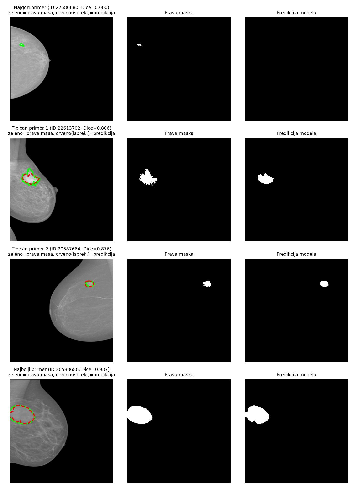

# Semantička segmentacija masa u mamografskim slikama pomoću DINOv2 modela

Adaptacija pretreniranog, self-supervised **DINOv2** modela (Oquab i dr., 2024, ViT-S/14)
za semantičku segmentaciju masa u mamografskim slikama iz **INBreast** baze podataka.
Projekat realizovan u okviru predmeta *Principi dubokog učenja*.

**Rezultat:** Dice **0.78** na nezavisnom test skupu (prosek 3 seed-a), uz samo 107 anotiranih
slika. Prezentacija sa odbrane projekta: [`docs/Prezentacija_odbrana_projekta.pdf`](docs/Prezentacija_odbrana_projekta.pdf).



*Zeleno: prava maska mase, crveno (isprekidano): predikcija modela. Prikazan je model čiji je test
Dice najbliži proseku (ne najbolji), da vizuelizacija ne bi bila „cherry-picking".*

## Sadržaj

- [Opis problema](#opis-problema)
- [Pristup](#pristup)
- [Rezultati](#rezultati)
- [Struktura repozitorijuma](#struktura-repozitorijuma)
- [Instalacija](#instalacija)
- [Podaci](#podaci)
- [Upotreba](#upotreba)
- [Metodološke napomene](#metodološke-napomene)
- [Ograničenja](#ograničenja)
- [Reference](#reference)

## Opis problema

Mamografija je standardni skrining metod za rano otkrivanje raka dojke. Precizna
segmentacija masa (lezija) pomaže dijagnostičkom procesu, ali ručna anotacija zahteva
iskusnog radiologa i skupa je da se sprovede na velikoj skali. Ovaj projekat ispituje
koliko se dobro **generičke, self-supervised naučene vizuelne osobine** (DINOv2,
treniran isključivo na prirodnim fotografijama, bez ijedne medicinske slike) mogu
preneti na segmentaciju masa uz minimalnu količinu dodatnih anotiranih podataka.

## Pristup

1. **Baseline**: potpuno zamrznut DINOv2 backbone (ViT-S/14) + trenabilna linearna
   segmentaciona glava (1×1 konvolucija nad patch tokenima).
2. **Augmentacija podataka**: geometrijske i intenzitetske transformacije nad trening
   skupom, radi smanjenja overfitting-a na malom broju primera.
3. **Postepen fine-tuning**: odmrzavanje poslednjih *N* transformer blokova backbone-a
   (N = 2, 4, 6), sa zasebnim, manjim learning rate-om od segmentacione glave.
4. **Statistička validacija**: svaka konfiguracija trenirana je sa tri nezavisna
   random seed-a; poređenja između uzastopnih konfiguracija rađena su uparenim t-testom
   (isti seed sa obe strane).
5. **Finalna evaluacija**: jednokratna, na potpuno nezavisnom test skupu.

## Rezultati

**Validacioni skup** (prosek ± std preko 3 seed-a). P-vrednosti porede svaku konfiguraciju
sa prethodnom u tabeli (kod: [`stat_tests.py`](stat_tests.py), izlaz:
[`results/summary/paired_ttests.csv`](results/summary/paired_ttests.csv)).

| Konfiguracija | Val Dice | Std | p (upareni t-test) |
|---|---|---|---|
| Baseline (zamrznut backbone) | 0.4995 | 0.0137 | n/a |
| + Augmentacija | 0.5169 | 0.0047 | 0.166 |
| + Fine-tuning (N=2 bloka) | 0.5532 | 0.0149 | 0.044 |
| + Fine-tuning (N=4 bloka) | 0.5768 | 0.0115 | 0.021 |
| + Fine-tuning (N=6 blokova) | 0.6709 | 0.0151 | 0.017 |

U svakom koraku je poboljšanje primećeno na sva 3 seed-a (sign test, jednostrani: p = 0.125,
što je najmanja moguća vrednost za 3 seed-a). Sa samo 3 seed-a p-vrednosti su orijentacione.
Poboljšanje od augmentacije nije statistički čvrsto.

**Finalna evaluacija na test skupu** (pobednička konfiguracija, N=6, prosek 3 seed-a;
po seed-u u [`results/summary/final_test_evaluation.csv`](results/summary/final_test_evaluation.csv)):

| Metrika | Vrednost | Std |
|---|---|---|
| Dice | 0.7813 | 0.0079 |
| IoU | 0.6789 | 0.0109 |
| Sensitivity (Recall) | 0.7546 | 0.0106 |
| Precision | 0.8924 | 0.0115 |

Test Dice (0.78) je viši od validacionog (0.67) za iste modele. Modeli se nisu menjali, a
validacioni i test skup imaju samo 13, odnosno 17 slika, pa je razlika najverovatnije posledica
sastava uzorka. Model je konzervativan (Precision 0.89, Sensitivity 0.75): najgori primer
prikazanog modela ima Dice 0, jer model nije detektovao vrlo malu, suptilnu masu.

## Struktura repozitorijuma

```
├── config.py                     # Sve putanje projekta na jednom mestu
├── napravi_split.py              # Deli INBreast podatke na train/val/test, GRUPISANO PO PACIJENTU
├── provera_maski_detaljno.py     # Kvantitativna i vizuelna verifikacija segmentacionih maski
├── dataset.py                    # PyTorch Dataset: učitavanje DICOM, normalizacija, augmentacija
├── model.py                      # Segmentacioni model: zamrznut/delimično odmrznut backbone + head
├── losses.py                     # Loss (BCE + Dice) i metrike (Dice, IoU, Sensitivity, Precision)
├── train.py                      # Trening jedne konfiguracije (train_one_run)
├── run_multi_seed.py             # Trening svih konfiguracija preko više random seed-ova
├── evaluate.py                   # Finalna evaluacija na test skupu
├── visualize_predictions.py      # Vizuelizacija predikcija na test primerima
├── stat_tests.py                 # Upareni t-test i sign test između uzastopnih konfiguracija
├── test_dataset.py               # Sanity-check za Dataset klasu
├── test_model.py                 # Sanity-check za arhitekturu modela
├── inbreast_split.json           # Sačuvana podela podataka (seed 42), putanje relativne u odnosu na bazu
├── requirements.txt
├── results/
│   ├── logs/                     # Log po epohama za svaki run (konfiguracija x seed)
│   ├── summary/                  # Agregirani rezultati, test evaluacija, p-vrednosti
│   └── figures/                  # Vizuelizacija predikcija
└── docs/                         # Prezentacija sa odbrane
```

Trenirani modeli (`checkpoints/*.pt`, ~86 MB svaki) i sama INBreast baza nisu u repozitorijumu.

## Instalacija

Zahtevani su Python 3.11 i PyTorch sa CUDA podrškom.

```bash
git clone https://github.com/Bastaja47/mammography-segmentation-dinov2.git
cd mammography-segmentation-dinov2

python -m venv venv
venv\Scripts\activate          # Windows
# source venv/bin/activate     # Linux/Mac

pip install torch torchvision --index-url https://download.pytorch.org/whl/cu128
pip install -r requirements.txt
```

DINOv2 backbone (`dinov2_vits14`) preuzima se automatski pri prvom pokretanju, preko
`torch.hub.load("facebookresearch/dinov2", "dinov2_vits14")`.

## Podaci

Ovaj repozitorijum **ne sadrži INBreast bazu**, nju treba obezbediti posebno. Očekivana
struktura foldera:

```
INBreast/
├── AllDICOMs/                      # DICOM mamogrami
└── extras/MassSegmentationMasks/   # gotove maske masa
```

Podrazumevano se baza traži u folderu `INBreast/` unutar projekta. Ako je negde drugde,
postavi promenljivu okruženja `INBREAST_ROOT`:

```powershell
$env:INBREAST_ROOT = "D:\podaci\INBreast"     # Windows PowerShell
```

```bash
export INBREAST_ROOT=/putanja/do/INBreast     # Linux/Mac
```

## Upotreba

```bash
# 1. Verifikacija ispravnosti gotovih segmentacionih maski (opciono, ali preporučeno)
python provera_maski_detaljno.py

# 2. Podela podataka (opciono: inbreast_split.json je već u repozitorijumu,
#    a seed 42 daje istu podelu)
python napravi_split.py

# 3. Sanity-check Dataset klase i modela (opciono)
python test_dataset.py
python test_model.py

# 4. Brz test jedne konfiguracije ili pun eksperimentalni protokol (15 treninga)
python train.py
python run_multi_seed.py        # za deo eksperimenta izmeni listu CONFIGS u fajlu

# 5. Finalna evaluacija pobedničke konfiguracije (N=6) na test skupu
python evaluate.py

# 6. Vizuelizacija primera predikcija
python visualize_predictions.py

# 7. Statistička poređenja konfiguracija (iz logova u results/logs/)
python stat_tests.py
```

Koraci 5 i 6 traže istrenirane modele u `checkpoints/`, koje stvara korak 4.

## Metodološke napomene

- **Zašto samo 107 slika:** INBreast ima 410 DICOM slika, ali za segmentaciju masa koriste
  se samo one sa gotovom maskom mase: 107 slika. Ostale ili nemaju nijednu leziju, ili imaju
  lezije koje nisu mase. Maske su prethodno proverene
  (`provera_maski_detaljno.py`): kvantitativno (intenzitet unutar maske naspram prstena tkiva
  oko nje) i vizuelno, bez sumnjivih slučajeva.
- **Podela po pacijentu, ne po slici:** sprečava curenje podataka između trening i test
  skupa (svaki pacijent ima u proseku 2.14 slike). Podela je 77 / 13 / 17 slika
  (35 / 7 / 8 pacijenata) za train / val / test.
- **Ponavljanje sa tri random seed-a:** dva identična baseline treninga sa različitim
  seed-om dala su val Dice 0.4748 i 0.5026, razliku veću od prvobitno pripisanog efekta
  augmentacije. Zato se svaka konfiguracija trenira sa seed-ovima 123, 456 i 789, a poređenja
  se rade uparenim testom (isti seed sa obe strane).
- **Test skup korišćen samo jednom:** finalna evaluacija sprovedena je tek nakon što
  je konfiguracija izabrana isključivo na osnovu validacionog skupa, i to nad sva tri
  modela, a ne samo nad „najboljim od tri".

## Ograničenja

- Mali obim podataka (107 slika) i mali val/test skupovi (13 i 17 slika).
- Samo 3 seed-a po konfiguraciji, veći broj bi dao uže intervale poverenja.
- Fiksna rezolucija (518×518) i jedna veličina backbone-a (ViT-S/14).
- Nema slika bez mase u evaluaciji, pa se ne može meriti specifičnost.

## Reference

- Oquab, M. et al. *DINOv2: Learning Robust Visual Features without Supervision.*
  arXiv:2304.07193 (2024). https://doi.org/10.48550/arXiv.2304.07193
- https://github.com/facebookresearch/dinov2
- INBreast baza podataka: Moreira, I. C. et al. *INbreast: toward a full-field
  digital mammographic database.* Academic Radiology (2012).

---

*Autor: Stojan Bastaja*
